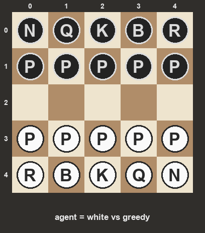
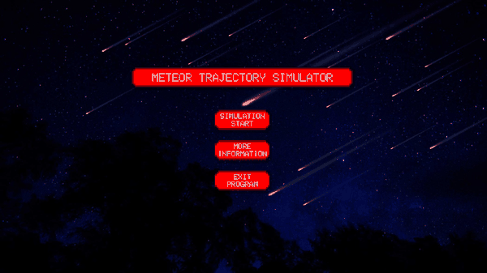
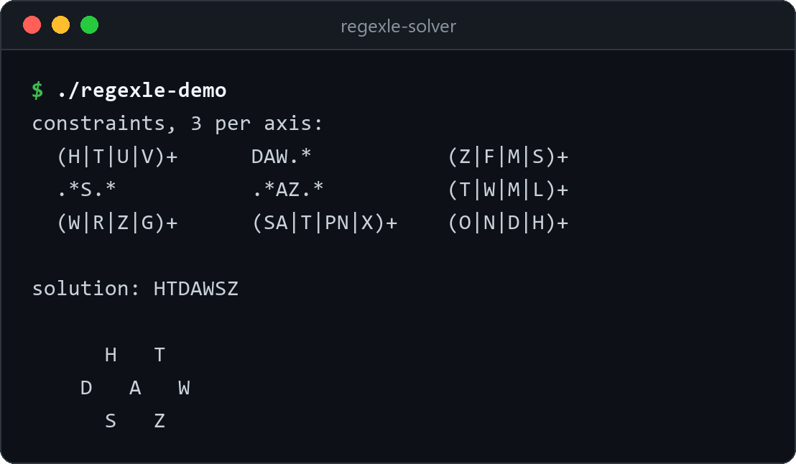

# Maheer Mirza

Computer Science student at the University of Southampton. Junior Tech Analyst at Syngenta, building data pipelines.

## Clinic Booking App · clinic-booking-app

  

**Book a sexual-health clinic appointment in under a minute: postcode search on a live map, slots generated from opening hours** · `Java 21 · JavaFX · Leaflet`  
**Email confirmations and reminders, reschedule/cancel, test-result and prescription tracking, keyboard and high-contrast support; 299 tests** · `PostgreSQL · JavaMail · JUnit 5`  
Team project, extended after the module.  

## Evidence-Based CV Reviewer · cv-reviewer

  

**Scores a CV with a deterministic rubric and matches it against 40 IT role profiles** · `Python · FastAPI`  
**Suggests edits from the CV's own lines and rejects rewrites that invent facts** · `JavaScript · Gemini (optional)`  

## Chess Variant AI · chess-agent

  

**Game-playing agent for Chess Fragments, a 5×5 chess variant with custom pieces** · `Python`  
**Alpha-beta minimax with iterative deepening, transposition table and move ordering; 79–1–0 in benchmarks** · `ChessMaker · pytest`  
Includes an independent rules engine verified move-for-move against the original (31,408 positions, 0 mismatches).  

## Graph Query Language Interpreter · rql-interpreter

  

**Interpreter for a SPARQL-style query language over RDF graphs** · `Haskell · Alex · Happy`  
**Lexer, parser, type checker and evaluator, plus a VS Code syntax extension** · `Haskell · TextMate`  
Team project, extended after the module.  

## Meteor Trajectory Simulator · meteor-trajectory-simulator

  

**Simulates a meteor from space to impact: RK4 gravity, atmospheric drag, heating and ablation** · `C# · Unity`  
**Estimates crater and blast radii and reverse-geocodes the impact site** · `Unity UI · REST`  
A-Level Computer Science NEA.  

## Regex Puzzle Solver · regexle-solver

  

**Solves hexagonal regex crosswords from their constraints** · `Haskell`  
**Regex parser, pretty printer and bounded language generator, with 60 tests** · `Haskell`  

