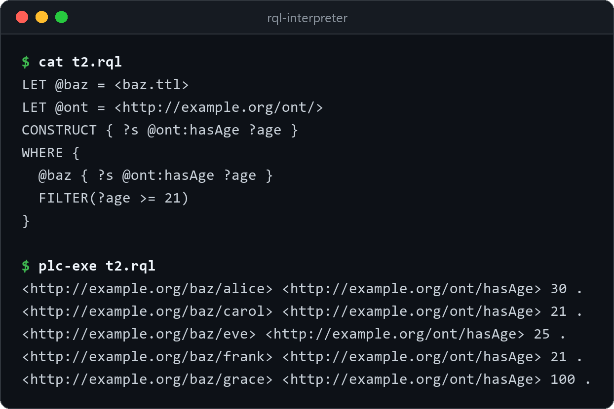
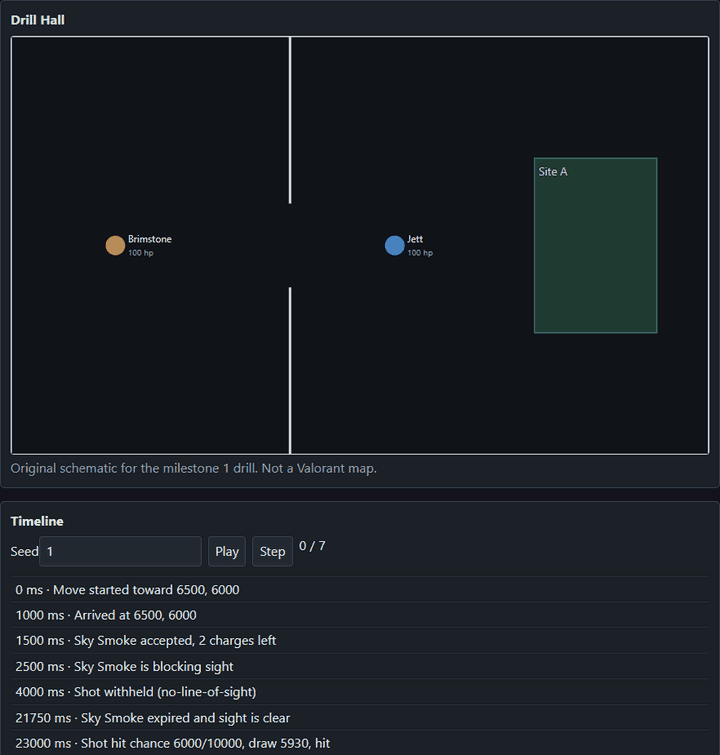
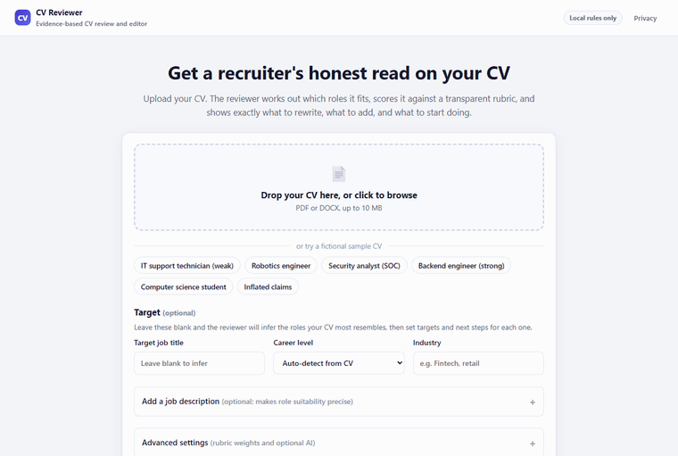

# Maheer Mirza

Computer Science student at the University of Southampton. Junior Tech Analyst at Syngenta, building data pipelines.

## Graph Query Language Interpreter · rql-interpreter

  

**Interpreter for a SPARQL-style query language over RDF graphs** · `Haskell · Alex · Happy`  
**Lexer, parser, type checker and evaluator, plus a VS Code syntax extension** · `Haskell · TextMate`  
Team project, extended after the module.  

## Tactical Shooter Simulator · valorant-simulator

  

**Deterministic 5v5 round engine: the same seed replays the same round, every time** · `TypeScript`  
**Line of sight, smokes, ability charges and a steppable event timeline** · `React · Vite · Vitest`  

## Evidence-Based CV Reviewer · cv-reviewer

  

**Scores a CV with a deterministic rubric and matches it against 40 IT role profiles** · `Python · FastAPI`  
**Suggests edits from the CV's own lines and rejects rewrites that invent facts** · `JavaScript · Gemini (optional)`  

## Clinic Booking App · clinic-booking-app

  

**Desktop app for booking clinic appointments, tracking tests and prescriptions, and email reminders** · `Java 21 · JavaFX`  
**Slots generated from opening hours; only bookings are stored, and full slots can't be overbooked** · `PostgreSQL · JUnit`  
Team project, extended after the module.  

## Regex Puzzle Solver · regexle-solver

  

**Solves hexagonal regex crosswords from their constraints** · `Haskell`  
**Regex parser, pretty printer and bounded language generator, with 60 tests** · `Haskell`  

